# KẾ HOẠCH TRIỂN KHAI KỸ THUẬT — IMAK-TOOL

## Industrial Motion Analysis & Kaizen Reporting Tool

> **Phiên bản tài liệu:** 2.0  
> **Ngày cập nhật:** 2026-08-07  
> **Mức sẵn sàng hiện tại:** Prototype nền tảng; chưa đủ điều kiện pilot nhà máy  
> **Mục tiêu của tài liệu:** Biến đề án thành kế hoạch có thể giao việc, kiểm thử, nghiệm thu và ra quyết định Go/No-Go  
> **Nguyên tắc an toàn:** Kết quả AI là bằng chứng hỗ trợ kỹ sư IE/Kaizen, không tự động kết luận người lao động “gây lãng phí” và không thay thế phê duyệt của con người.

---

## 0. TÓM TẮT QUYẾT ĐỊNH

### 0.1 Kết luận về tính khả thi

| Mức triển khai | Kết luận | Điều kiện |
|---|---|---|
| Demo kỹ thuật có kiểm soát | **Khả thi trong 4 tuần** | Một người, camera cố định, video ngắn, xử lý theo frame sampling, chưa cam kết độ chính xác sản xuất |
| Pilot tại một công đoạn | **Khả thi có điều kiện trong 8–10 tuần** | Có bộ video gán nhãn, benchmark đúng máy đích, privacy được phê duyệt, giải quyết contract ảnh đa phương thức |
| Triển khai production nhiều dây chuyền | **Chưa đủ dữ liệu để cam kết** | Cần thêm 4–8 tuần hardening sau pilot, giám sát vận hành, bảo mật, nhiều camera/product variant và tiêu chí hỗ trợ |

Không sử dụng lại kết luận cũ “tích hợp được 100%”. Tính khả thi tổng thể phụ thuộc vào năm gate bắt buộc:

1. **G1 – Multimodal transport:** truyền được ảnh thật đến VLM qua contract đã kiểm thử; Base64 đặt trong chuỗi prompt không được coi là ảnh.
2. **G2 – Local correctness:** local pipeline chạy end-to-end, artifact đúng schema và không phụ thuộc network.
3. **G3 – Accuracy:** đo trên bộ test giữ riêng, không đo trên video dùng để chỉnh threshold.
4. **G4 – Privacy/AI:** dữ liệu mặc định là `confidential`; chỉ gửi cloud sau sanitize, policy approval và AI contract test.
5. **G5 – Release readiness:** đạt SLA, reliability và recovery đã chốt bằng test trên đúng máy đích.

### 0.2 Phạm vi MVP được khóa

MVP chỉ hỗ trợ:

- Một công nhân chính trong vùng thao tác.
- Camera cố định, không pan/zoom trong lúc ghi.
- Góc nhìn đủ thấy vai, khuỷu tay và cổ tay; ưu tiên thân trên hoặc toàn thân.
- Một loại chu kỳ lặp chính trong mỗi job phân tích.
- Video 720p hoặc 1080p, tối đa 10 phút/job; 4K được resize trước suy luận.
- Xử lý local cho decode, pose, motion, event và chọn keyframe.
- Cloud VLM là tùy chọn và chỉ dùng khi policy cho phép.
- Kết quả “idle candidate” phải được kỹ sư IE xác nhận trước khi đổi nhãn thành Muda.

Ngoài phạm vi MVP:

- Nhận diện danh tính, chấm điểm năng suất cá nhân hoặc giám sát kỷ luật.
- Nhiều người tương tác/chồng lấp trong cùng vùng thao tác.
- Camera cầm tay, camera di động, nhiều camera đồng bộ hoặc 3D pose.
- Tự động điều khiển máy, PLC hoặc ra quyết định an toàn.
- Cam kết pháp lý/y tế về ergonomic.
- Huấn luyện mô hình foundation mới trên laptop đích.

### 0.3 Sản phẩm bàn giao của pilot

Một pilot được coi là hoàn chỉnh khi tạo được, theo cùng một `analysis_id`:

1. `manifest.json`: thông tin job, file đầu vào, phiên bản phần mềm và hash.
2. `motion_analysis.json`: pose quality, cycles, idle candidates và confidence.
3. `evidence/`: keyframe đã chọn, timestamp, checksum và trạng thái sanitize.
4. `kaizen_report.json`: nhận xét có evidence, confidence và trạng thái người duyệt.
5. `Kaizen_Report.pptx`: báo cáo doanh nghiệp có truy xuất nguồn gốc.
6. `run_metrics.json`: latency từng stage, peak RAM, provider/cost và lỗi/retry.
7. Audit log không chứa raw frame hoặc Base64.

---

## 1. BÀI TOÁN, NGƯỜI DÙNG VÀ QUY TẮC NGHIỆP VỤ

### 1.1 Bài toán cần giải quyết

Kỹ sư IE/Kaizen hiện phải xem video, bấm giờ, ghi chú dừng/chờ, chọn ảnh và làm báo cáo thủ công. IMAK-Tool giảm thời gian chuẩn bị bằng cách:

1. Chuẩn hóa và kiểm tra chất lượng video.
2. Trích xuất chuyển động tay có timestamp và confidence.
3. Đề xuất ranh giới chu kỳ và các đoạn ít chuyển động.
4. Chọn bằng chứng hình ảnh đại diện.
5. Sinh nhận xét Kaizen có cấu trúc, nếu policy cho phép dùng VLM.
6. Tạo báo cáo để kỹ sư IE xem, sửa và phê duyệt.

### 1.2 Người dùng và quyền

| Vai trò | Quyền chính | Không được phép |
|---|---|---|
| Operator/Recorder | Ghi và tải video được phép | Phê duyệt kết luận Kaizen |
| IE Analyst | Khai báo context, sửa cycle/idle, duyệt evidence | Thay đổi audit log |
| Supervisor/Approver | Phê duyệt báo cáo và action item | Xem raw data ngoài phạm vi được phân quyền |
| Admin | Cấu hình provider, retention, model và threshold version | Tự gắn dữ liệu thành `cloud_safe` nếu chưa qua policy |

### 1.3 Định nghĩa nghiệp vụ bắt buộc

- **Low-motion/idle candidate:** đoạn cổ tay có vận tốc thấp theo thuật toán. Đây là quan sát tín hiệu, chưa phải lãng phí.
- **Muda đã xác nhận:** idle candidate được người có thẩm quyền phân loại là chờ đợi/lãng phí theo chuẩn công đoạn.
- **Valid hold:** giữ/ép/kiểm tra/chờ máy theo tiêu chuẩn; không được tự động tính là Muda.
- **Cycle:** khoảng `[start_sec, end_sec)` của một lần hoàn thành thao tác lặp.
- **Evidence:** frame có timestamp nằm trong hoặc gần event/cycle, đủ rõ và truy xuất được về video nguồn.
- **AI finding:** đề xuất từ VLM; luôn có `review_status` là `pending`, `accepted`, `edited` hoặc `rejected`.

### 1.4 Giả định phải xác nhận trước pilot

Owner sản phẩm phải ký xác nhận checklist sau:

- [ ] Công đoạn và product variant cụ thể.
- [ ] Số người tối đa trong khung hình là 1.
- [ ] Camera, độ cao, khoảng cách và ROI được cố định.
- [ ] Khoảng cycle dự kiến: `min_cycle_sec` và `max_cycle_sec`.
- [ ] Định nghĩa local của idle, valid hold, machine wait và Muda.
- [ ] Người được phép xem video/keyframe/report.
- [ ] Retention cho raw video, evidence, JSON, PPTX và log.
- [ ] Có/không cho phép cloud; danh sách provider/model/region được duyệt.
- [ ] Người chịu trách nhiệm gán nhãn ground truth và phê duyệt báo cáo.

Nếu một mục chưa được xác nhận, job pilot phải hiển thị `BLOCKED_BY_POLICY` hoặc `NEEDS_CONFIGURATION`, không tự chọn giá trị ngầm.

---

## 2. YÊU CẦU CHỨC NĂNG CÓ THỂ NGHIỆM THU

| ID | Yêu cầu | Hành vi bắt buộc | Tiêu chí hoàn thành |
|---|---|---|---|
| FR-01 | Tạo analysis job | Nhận video và context; sinh UUID; không sửa file nguồn | Manifest có SHA-256, metadata, config/version và trạng thái ban đầu |
| FR-02 | Validate video | Kiểm tra tồn tại, codec, duration, FPS/timestamp, rotation, resolution, dung lượng | Video lỗi bị từ chối bằng mã lỗi rõ; không tạo output dở dang |
| FR-03 | Quality gate | Đo sáng, blur, camera motion, pose coverage, số người | Trả `PASS/WARN/FAIL` và reason code; `FAIL` không gọi cloud |
| FR-04 | Pose tracking | Trích xuất shoulder/elbow/wrist theo timestamp ở sampled FPS | Mỗi sample có visibility/presence; mẫu kém không được nội suy vô hạn |
| FR-05 | Motion feature | Smoothing theo thời gian; vận tốc chuẩn hóa theo cơ thể; gap handling | Có unit test cho FPS/timestamp khác nhau và landmark mất |
| FR-06 | Idle candidate | Hysteresis, min duration, gap merge, confidence | Xuất segment `[start,end)` và evidence; không tự gắn Muda |
| FR-07 | Cycle analysis | Ước lượng period, kiểm tra harmonic/stability, tìm boundaries | Xuất từng cycle, confidence và reason khi không đủ dữ liệu |
| FR-08 | Keyframe selection | Chọn theo event/cycle, blur, diversity và coverage | Evidence không trùng quá mức; tất cả file có timestamp/hash |
| FR-09 | Privacy sanitize | Crop/redact metadata/khuôn mặt/badge/screen theo policy | Chỉ artifact đạt policy mới có thể đổi sang `cloud_safe` |
| FR-10 | VLM advisory | Gửi motion summary + evidence qua transport hỗ trợ ảnh | Output được validate schema; lỗi model không làm mất local result |
| FR-11 | Human review | Cho sửa/duyệt/reject finding, cycle và idle label | Lưu actor, timestamp, old/new value và reason |
| FR-12 | PPTX report | Tạo report từ dữ liệu đã duyệt | Mở được bằng PowerPoint; không overflow; font Việt đúng |
| FR-13 | Dashboard | Upload, progress, review, cancel, resume/retry, download | Rerun UI không chạy trùng job; trạng thái tồn tại bền vững |
| FR-14 | Audit/observability | Ghi stage time, error, retry, model/cost, version | Không log secret/raw image/Base64; truy được theo `analysis_id` |
| FR-15 | Local-only mode | Hoàn thành motion analysis khi cloud tắt | Sinh JSON và report định lượng với AI section ghi “không sử dụng” |

### 2.1 Trạng thái job

```text
CREATED
  -> VALIDATING
  -> QUALITY_CHECK
  -> LOCAL_ANALYSIS
  -> REVIEW_REQUIRED
  -> SANITIZING (nếu dùng cloud)
  -> AI_ANALYSIS (nếu policy cho phép)
  -> REPORTING
  -> COMPLETED

Từ mọi stage có thể chuyển sang:
  FAILED_RETRYABLE | FAILED_FINAL | CANCELLED | BLOCKED_BY_POLICY
```

Quy tắc:

- Chuyển trạng thái phải atomic và có timestamp.
- Retry tiếp tục từ artifact hợp lệ gần nhất, không decode lại nếu không cần.
- `COMPLETED` chỉ được ghi sau khi JSON và PPTX đã được ghi atomically rồi rename.
- Cancel phải đóng `VideoCapture`, xóa temp file theo retention và không xóa file nguồn.

---

## 3. YÊU CẦU PHI CHỨC NĂNG VÀ SLA

### 3.1 Performance budget ban đầu

Máy chuẩn: Windows 10/11 x64, Intel i5-8265U 4C/8T, RAM 16 GB, Intel UHD 620, không CUDA.

Không chốt `<60 giây/video 3 phút` trước benchmark. Dùng hai mức:

| Mức | Video chuẩn | Mục tiêu pilot | Điều kiện |
|---|---|---|---|
| Target | 3 phút, 1080p/30 FPS | Local pipeline ≤ 120 giây ở P95 | Pose 5 sampled FPS, resize long side 640, một người |
| Stretch | 3 phút, 1080p/30 FPS | End-to-end gồm cloud ≤ 90 giây ở P95 | Network ổn định và provider không retry |

Ngân sách tham chiếu cho target 120 giây:

| Stage | Budget P95 | Ghi chú |
|---|---:|---|
| Validate + probe | 3 s | Dùng metadata/probe, không decode toàn video |
| Streaming decode + pose | 75 s | Stage chi phối; benchmark 3/5/8 sampled FPS |
| Feature + event + cycle | 10 s | Vectorized; FFT autocorrelation |
| Keyframe encode/sanitize | 12 s | Tối đa 8 ảnh, kích thước giới hạn |
| Local persistence | 5 s | Atomic write |
| Dự phòng | 15 s | OS/process variance |

Cloud VLM và PPTX được đo riêng để không che giấu bottleneck local.

### 3.2 Resource limit

- Peak working set mục tiêu: ≤ 2 GB/job local ở P95.
- Không giữ toàn bộ frame trong RAM; pipeline streaming với bounded queue.
- Tối đa 1 job CPU-heavy đồng thời trên máy chuẩn.
- Temp space dự báo trước khi chạy; dừng sớm nếu không đủ disk.
- Evidence mặc định tối đa 8 ảnh/job, mỗi ảnh sau sanitize ≤ 1.5 MB.

### 3.3 Reliability và reproducibility

- Cùng input hash + config/version phải cho local numeric output tương đương trong tolerance.
- Tất cả threshold, model, prompt và schema đều có version.
- Dependency phải pin/lock cho Python 3.11 Windows x64; CI kiểm thử thêm Python hỗ trợ nếu cần.
- Không ghi đè artifact hoàn chỉnh bằng artifact của retry thất bại.
- Local analysis vẫn sử dụng được khi mất mạng/provider lỗi.

### 3.4 Security và privacy

- Secrets chỉ lấy từ environment/secret store, không ghi trong repo, JSON, log hoặc PPTX.
- Raw video/keyframe mặc định `confidential`.
- Không log prompt chứa ảnh/Base64.
- Audit log ghi metadata cần thiết nhưng không chứa dữ liệu nhạy cảm.
- Cloud egress chỉ qua allowlist provider/model/region.
- Có cấu hình retention và lệnh purge theo `analysis_id`.

---

## 4. HIỆN TRẠNG CODEBASE VÀ GAP

Trạng thái đã kiểm tra ngày 2026-08-07:

| Thành phần | Hiện trạng | Gap cần xử lý |
|---|---|---|
| `src/core/video_processor.py` | Có xử lý video/object tracking/enhance light của ứng dụng cũ | Không phải pipeline motion analysis; chỉ tái sử dụng utility phù hợp |
| `src/gui/app_gui.py` | GUI Tkinter cho remove/mask/enhance | Chưa tích hợp IMAK; không nhồi thêm workflow mới vào lớp GUI lớn |
| `src/industrial_ai/video_reader.py` | Có metadata và trích keyframe theo interval | Phải tách decode stream khỏi keyframe selection; sửa typing, timestamp/VFR, write error và test |
| `pose_tracker.py` | Chưa có | Xây mới |
| `signal_preprocessor.py` | Chưa có | Xây mới |
| `idle_detector.py` | Chưa có | Xây mới |
| `cycle_detector.py` | Chưa có | Xây mới |
| `quality_gate.py` | Chưa có | Xây mới |
| `privacy_sanitizer.py` | Chưa có | Xây mới |
| `router_client.py` | Chưa có | Chỉ xây sau G1 spike |
| `ai_kaizen_advisor.py` | Chưa có | Xây mới, tách khỏi transport |
| `ppt_generator.py` | Chưa có | Xây mới |
| `app/streamlit_app.py` | Chưa có | Xây sau khi core E2E ổn định |
| Test suite IMAK | Chưa có | Bắt buộc tạo từ Phase 0 |
| `requirements.txt` | Có lower bounds; thiếu lock và một số package | Chốt dependency sau spike; không để version trôi |

Không được coi `VideoReader` hiện tại là “Phase 1 hoàn thành”. Nó mới là skeleton và chưa có test.

---

## 5. QUYẾT ĐỊNH KIẾN TRÚC

### 5.1 Kiến trúc mục tiêu

```mermaid
flowchart LR
    UI[Streamlit/UI Adapter] --> JOB[Job Service]
    JOB --> VAL[Video Validator]
    VAL --> QG[Quality Gate]
    QG --> DEC[Streaming Decoder]
    DEC --> POSE[Pose Tracker CPU]
    POSE --> PRE[Signal Preprocessor]
    PRE --> IDLE[Idle Candidate Detector]
    PRE --> CYCLE[Cycle Detector]
    DEC --> KF[Keyframe Selector]
    IDLE --> KF
    CYCLE --> KF
    KF --> PRIV[Privacy Sanitizer]
    PRIV --> POLICY{Cloud Policy}
    POLICY -->|denied/offline| LOCAL[Local-only Result]
    POLICY -->|approved| ADV[AI Kaizen Advisor]
    ADV --> TX[VLM Transport Adapter]
    TX --> VLM[Approved Vision Model]
    LOCAL --> REVIEW[Human Review]
    ADV --> REVIEW
    REVIEW --> PPT[PPTX Generator]
    JOB --> STORE[Artifact Store + Audit]
```



### 5.2 Ranh giới module

| Module | Trách nhiệm | Không làm |
|---|---|---|
| `video_io.py` | Probe, normalize rotation/timestamp, yield frame | Chọn keyframe, pose, business rule |
| `quality_gate.py` | Đánh giá input và pose coverage sơ bộ | Tự sửa video hoặc gọi cloud |
| `pose_tracker.py` | Chuyển frame thành landmark samples | Kết luận Muda/cycle |
| `signal_preprocessor.py` | Visibility gate, gap policy, smoothing, normalized velocity | Phân loại nghiệp vụ |
| `idle_detector.py` | Sinh low-motion segments + confidence | Gắn nhãn Muda cuối cùng |
| `cycle_detector.py` | Period candidates, boundaries, confidence | Ép kết quả khi không đủ cycle |
| `keyframe_selector.py` | Xếp hạng evidence theo event/cycle/quality/diversity | Quyết định privacy |
| `privacy_sanitizer.py` | Redact/crop/strip metadata, tạo audit metadata | Tự phê duyệt cloud |
| `vlm_transport.py` | Gửi structured text/image, timeout/retry/provider result | Prompt nghiệp vụ, repair schema |
| `ai_kaizen_advisor.py` | Prompt, schema validation, repair, evidence binding | Chứa API key/provider SDK logic |
| `report_service.py` | Chuẩn bị view model và sinh PPTX | Tính lại motion metric |
| `job_service.py` | State machine, checkpoint, cancel, orchestration | Chứa thuật toán CV |

### 5.3 Quyết định ADR cần chốt

#### ADR-001 – Xử lý streaming một lượt

- **Chọn:** decode tuần tự một lần, chỉ giữ buffer nhỏ và artifact cần thiết.
- **Lý do:** phù hợp RAM 16 GB và giảm I/O.
- **Không chọn:** đọc toàn bộ video vào list frame.

#### ADR-002 – Frame sampling có timestamp

- **Chọn:** sampling theo thời gian mục tiêu, không dựa duy nhất vào `frame_idx % N`.
- **Lý do:** xử lý VFR, frame drop và FPS metadata sai.
- **Bắt buộc:** lưu `timestamp_ms` gốc và `source_frame_index` nếu có.

#### ADR-003 – Idle là candidate, không phải kết luận

- **Chọn:** thuật toán chỉ phát hiện low-motion; IE analyst xác nhận ngữ cảnh.
- **Lý do:** tay đứng yên có thể là thao tác hợp lệ.

#### ADR-004 – VLM transport qua abstraction

- **Chọn:** `VLMTransport` protocol độc lập với `nakazasen-ai-router`.
- **Lý do:** router v0.5.1 chưa có structured image content.
- **Phương án G1:**
  - A: adapter gọi trực tiếp approved VLM SDK cho multimodal, router dùng cho text-only/fallback metadata.
  - B: fork/nâng router để hỗ trợ image parts và capability filter.
- **Cách chọn:** spike 2 ngày, integration test cùng một ảnh qua candidate; ưu tiên A nếu B không hoàn tất trong timebox.

#### ADR-005 – Privacy fail-closed

- **Chọn:** mặc định `confidential`; chỉ policy service đổi trạng thái sau sanitizer.
- **Lý do:** ảnh nén không đồng nghĩa ảnh an toàn.

#### ADR-006 – Typed contracts

- **Chọn:** Pydantic models + JSON Schema export.
- **Lý do:** loại bỏ dictionary tự do, version contract và validate input/output.

---

## 6. DATA MODEL VÀ CONTRACT

### 6.1 Quy ước chung

- Thời gian dùng giây dạng `number`, mốc bắt đầu inclusive và mốc kết thúc exclusive: `[start_sec, end_sec)`.
- Frame index bắt đầu từ 0; timestamp là nguồn sự thật khi video VFR.
- Tỷ lệ dùng số `[0,1]`, không lưu chuỗi có `%`.
- Mỗi schema có `schema_version` theo semantic version.
- Mỗi artifact có `analysis_id`, `created_at`, `software_version` và `source_video_sha256`.
- Confidence là số `[0,1]` và phải có `confidence_reason`/quality flags khi thấp.

### 6.2 Entity chính

#### `AnalysisJob`

| Field | Type | Rule |
|---|---|---|
| `analysis_id` | UUID | Bắt buộc, immutable |
| `status` | enum | Theo state machine |
| `input_uri` | string | Local path nội bộ; không đưa vào cloud |
| `source_video_sha256` | string | 64 ký tự hex |
| `context` | `JobContext` | Công đoạn, product, operator alias, cycle range |
| `config_version` | string | Bắt buộc |
| `privacy_class` | enum | `confidential`, `cloud_safe`, `public` |
| `review_status` | enum | `pending`, `approved`, `rejected` |

#### `PoseSample`

| Field | Type | Rule |
|---|---|---|
| `timestamp_sec` | float | ≥ 0, tăng đơn điệu |
| `landmark` | enum | shoulder/elbow/wrist trái/phải |
| `x`, `y`, `z` | float/null | Normalized; null nếu invalid |
| `visibility`, `presence` | float | `[0,1]` |
| `valid` | bool | Theo quality threshold/version |

#### `TemporalSegment`

| Field | Type | Rule |
|---|---|---|
| `segment_id` | string | Unique trong analysis |
| `start_sec`, `end_sec` | float | `0 ≤ start < end ≤ duration` |
| `type` | enum | `low_motion`, `valid_hold`, `machine_wait`, `confirmed_muda`, `unknown` |
| `hand` | enum | `left`, `right`, `both`, `unknown` |
| `confidence` | float | `[0,1]` |
| `review_status` | enum | Mặc định `pending` |
| `evidence_ids` | array[string] | Chỉ tham chiếu evidence tồn tại |

#### `Cycle`

| Field | Type | Rule |
|---|---|---|
| `cycle_id` | string | Unique |
| `start_sec`, `end_sec`, `duration_sec` | float | Duration khớp trong tolerance 1 ms |
| `confidence` | float | `[0,1]` |
| `boundary_method` | enum | `fft_phase`, `dtw`, `manual`, `hybrid` |
| `is_partial` | bool | True cho đầu/cuối video dở chu kỳ |

#### `Evidence`

| Field | Type | Rule |
|---|---|---|
| `evidence_id` | string | Unique |
| `timestamp_sec` | float | Nằm trong video |
| `image_path` | string | Local artifact path |
| `sha256` | string | Bắt buộc |
| `mime_type` | enum | `image/jpeg`, `image/png` |
| `width`, `height`, `size_bytes` | integer | > 0 |
| `blur_score`, `diversity_score` | float | Có version thuật toán |
| `sanitization_status` | enum | `raw`, `sanitized`, `rejected` |
| `redactions` | array | Loại và bounding box đã che |

#### `KaizenFinding`

| Field | Type | Rule |
|---|---|---|
| `finding_id` | string | Unique |
| `category` | enum | good point/problem/opportunity/unknown |
| `title`, `description` | string | Có giới hạn độ dài |
| `evidence_ids` | array[string] | Tối thiểu 1 nếu là visual claim |
| `confidence` | float | `[0,1]` |
| `review_status` | enum | Mặc định `pending` |
| `source` | enum | `rule`, `vlm`, `human` |

#### `ActionItem`

Bao gồm `action_id`, `finding_ids`, `action`, `owner`, `due_date`, `priority`, `expected_benefit`, `verification_method`, `status`. VLM không được tự điền owner/due date như sự thật; nếu chưa có thì để `null`.

### 6.3 Contract multimodal tối thiểu

```python
class VLMTransport(Protocol):
    def analyze(self, request: VLMRequest, timeout_sec: float) -> VLMResponse: ...

class VLMRequest(BaseModel):
    analysis_id: UUID
    task_type: Literal["kaizen_video_analysis"]
    text_prompt: str
    motion_summary: MotionSummary
    images: list[ImagePart]          # bytes/path được adapter chuyển đúng API provider
    privacy: CloudPrivacyMetadata
    response_schema_version: str

class VLMResponse(BaseModel):
    raw_text: str
    parsed_report: KaizenReport | None
    provider_name: str
    model_name: str
    attempts: list[Attempt]
    cost_estimate: CostEstimate | None
```

Yêu cầu test contract:

- Mock adapter xác nhận `images` là image parts, không phải chuỗi Base64 trong prompt.
- Capability filter loại model text-only.
- Timeout và retry không gửi lại request sau cancellation.
- Attempts/cost được đọc từ response/metadata đúng contract adapter.
- JSON sai được repair tối đa 1 lần; vẫn sai thì `AI_OUTPUT_INVALID`, không đoán field.

### 6.4 Cấu trúc artifact

```text
artifacts/<analysis_id>/
├── manifest.json
├── config_snapshot.json
├── motion_analysis.json
├── kaizen_report.json
├── run_metrics.json
├── evidence/
│   ├── raw/                 # chỉ tồn tại nếu retention cho phép
│   └── sanitized/
├── reports/
│   └── Kaizen_Report.pptx
└── tmp/                     # xóa khi complete/cancel/fail theo policy
```

---

## 7. THIẾT KẾ THUẬT TOÁN THỰC DỤNG

### 7.1 Video validation và quality gate

Pipeline kiểm tra theo thứ tự:

1. File tồn tại, readable, extension chỉ là gợi ý; codec/container phải probe thực tế.
2. Duration > 0, timestamp đọc được, resolution trong giới hạn.
3. Normalize rotation/mirror theo metadata và config camera.
4. Sample nhanh 10–20 frame để đo brightness, blur và camera motion.
5. Chạy pose warm-up trên sample để đo coverage và số người.
6. Trả `PASS`, `WARN` hoặc `FAIL` với reason codes.

Reason codes tối thiểu: `UNSUPPORTED_CODEC`, `INVALID_DURATION`, `FPS_UNKNOWN`, `TOO_DARK`, `MOTION_BLUR`, `CAMERA_MOVING`, `POSE_COVERAGE_LOW`, `MULTIPLE_PEOPLE`, `BODY_OUT_OF_FRAME`.

Quality threshold phải hiệu chỉnh trên camera pilot, không hard-code chung cho 720p–4K.

### 7.2 Pose sampling

- Mặc định thử nghiệm: 5 samples/second.
- Resize giữ aspect ratio, long side 640; lưu scale transform nếu cần overlay.
- Dùng MediaPipe video mode và timestamp millisecond tăng đơn điệu.
- Chỉ nhận landmark khi visibility và presence đạt threshold cấu hình.
- Gap ngắn tối đa `max_gap_sec` có thể nội suy; gap dài giữ null và giảm confidence.
- Nếu pose coverage dưới gate, không chạy cycle/Muda như thể dữ liệu đầy đủ.

### 7.3 Smoothing theo thời gian

EMA cố định `alpha=0.35` không ổn khi sampled FPS thay đổi. Dùng time-aware EMA:

\[
\alpha_t = 1 - e^{-\Delta t / \tau}, \qquad
\hat{P}_t = \alpha_t P_t + (1-\alpha_t)\hat{P}_{t-1}
\]

- `tau` là time constant cấu hình/calibrate.
- Reset filter sau gap dài.
- Có thể đánh giá One Euro Filter trong benchmark, nhưng không mô tả là đã dùng nếu chưa implement/test.

### 7.4 Vận tốc chuẩn hóa

Không dùng trực tiếp khoảng cách normalized theo kích thước ảnh. Chuẩn hóa bằng shoulder width hoặc torso scale hợp lệ:

\[
v_t = \frac{\lVert \hat{P}_t - \hat{P}_{t-1} \rVert}{\Delta t \cdot \max(S_t, \epsilon)}
\]

Trong đó `S_t` là shoulder width/torso scale đã smooth. Nếu scale invalid, sample velocity là null thay vì dùng giá trị giả.

### 7.5 Idle candidate với hysteresis

Tham số phải nằm trong `config_snapshot.json`:

- `enter_idle_velocity`: ngưỡng đi vào idle.
- `exit_idle_velocity`: ngưỡng thoát idle, lớn hơn enter threshold.
- `min_idle_sec`: thời lượng tối thiểu.
- `max_gap_sec`: gap nhiễu được merge.
- `min_valid_ratio`: tỷ lệ pose sample hợp lệ trong segment.

Thuật toán:

1. Chỉ xét mẫu velocity hợp lệ.
2. Vào trạng thái idle khi tín hiệu dưới `enter` đủ thời gian debounce.
3. Chỉ thoát khi vượt `exit` đủ thời gian debounce.
4. Merge gap ngắn; bỏ segment thiếu valid samples.
5. Tính confidence từ valid ratio, margin so với threshold và stability.
6. Xuất `low_motion`; chờ review để đổi thành `valid_hold`, `machine_wait` hoặc `confirmed_muda`.

### 7.6 Cycle detection có confidence

Quy trình MVP:

1. Tạo motion energy tổng hợp từ hai tay; mask đoạn pose invalid.
2. Resample lên time grid đều.
3. Detrend và normalize robust.
4. Tính autocorrelation bằng FFT trong `[min_cycle_sec, max_cycle_sec]`.
5. Tìm peak có prominence; kiểm tra peak ở `T/2`, `T`, `2T` để tránh harmonic.
6. So sánh period theo nhiều cửa sổ; tính stability.
7. Nếu đủ tin cậy, dùng template/phase alignment hoặc DTW để tìm boundaries.
8. Đánh dấu cycle đầu/cuối dở dang là `is_partial=true`.
9. Nếu video có <3 cycles hợp lệ hoặc confidence thấp, trả `INSUFFICIENT_CYCLES` và yêu cầu manual boundaries.

Không dùng `np.argmax` đơn giản trên autocorrelation chưa normalize. Không chạy `np.correlate` O(N²) cho chuỗi dài.

### 7.7 Keyframe selection theo evidence

Candidate phải đến từ:

- Trung tâm/biên của idle candidate.
- Đỉnh motion energy hoặc phase đại diện của cycle.
- Finding cần bằng chứng cụ thể.

Xếp hạng theo:

1. Liên quan event/cycle.
2. Blur thấp sau khi normalize kích thước.
3. Pose visibility cao.
4. Không trùng hình với ảnh đã chọn; SSIM tính trên thumbnail/ROI.
5. Bao phủ các loại event và phase khác nhau.

Tối đa 8 ảnh mặc định. Nếu không có ảnh đạt quality, report ghi thiếu evidence; không chọn ảnh mờ chỉ để đủ số lượng.

### 7.8 VLM và schema repair

- Prompt chỉ nhận metric đã validate và evidence đã sanitize.
- VLM phải trích dẫn `evidence_id` cho visual claim.
- Parser loại bỏ code fence nhưng không tự sửa semantic field tùy ý.
- Lần 1: parse/validate.
- Lần 2 duy nhất: gửi validation errors và yêu cầu repair JSON.
- Vẫn lỗi: lưu raw response theo policy, ghi `AI_OUTPUT_INVALID`, hoàn thành local report.
- Không cho VLM thay đổi cycle time/muda duration đã tính local; nó chỉ diễn giải và đề xuất.

---

## 8. PRIVACY, AN TOÀN VÀ QUẢN TRỊ AI

### 8.1 Data classification

| Dữ liệu | Mặc định | Có thể lên cloud? |
|---|---|---|
| Raw video | `confidential` | Không trong MVP |
| Raw keyframe | `confidential` | Không |
| Sanitized keyframe | `confidential` cho đến khi policy duyệt | Có, nếu chuyển thành `cloud_safe` |
| Motion numeric summary | `confidential` | Theo policy |
| PPTX/report | `confidential` | Không mặc định |
| Aggregate metrics đã ẩn danh | Theo owner | Có thể |

### 8.2 Sanitization pipeline

1. Crop đúng ROI nghiệp vụ, loại vùng không cần thiết.
2. Detect/redact face, badge/nameplate, screen, barcode/serial theo policy.
3. Strip EXIF/metadata.
4. Resize/compress theo giới hạn.
5. Tạo SHA-256 của output sanitized.
6. Lưu `sanitized_by`, `sanitizer_version`, `redactions`, `reviewer` và thời gian.
7. Policy engine quyết định allow/deny.

Nếu sanitizer không chắc chắn hoặc detector lỗi, mặc định deny cloud.

### 8.3 Human oversight

- Báo cáo hiển thị rõ metric nào từ thuật toán, nội dung nào do VLM và nội dung nào do người sửa.
- Không hiển thị confidence thấp như kết luận chắc chắn.
- Action item phải có người duyệt trước khi đưa vào bản phát hành.
- Lưu feedback accepted/edited/rejected để đánh giá, không tự động dùng làm training data nếu chưa có consent.

---

## 9. CHIẾN LƯỢC KIỂM THỬ VÀ GROUND TRUTH

### 9.1 Bộ dữ liệu pilot tối thiểu

Mục tiêu tối thiểu trước Gate G3:

- 30 video, chia theo job/video để tránh leakage.
- Ít nhất 3 operator tự nguyện, 2 product variants, 2 điều kiện ánh sáng.
- Có video tốt và edge cases: tối, che khuất, PPE, frame drop, dở chu kỳ.
- 20 video cho development/calibration; 10 video held-out chỉ dùng nghiệm thu.
- Hai người gán nhãn độc lập cho cycle boundary và idle context; xử lý bất đồng bằng reviewer thứ ba.

Nếu không thu được mức đa dạng trên, báo cáo phải giới hạn claim đúng vào dữ liệu đã có.

### 9.2 Annotation guide

Mỗi annotation gồm:

- Cycle `[start,end)` và partial flag.
- Low-motion interval theo từng tay.
- Context label: valid hold, machine wait, confirmed Muda, unknown.
- Quality flags và đoạn pose không quan sát được.
- Evidence frame chấp nhận/không chấp nhận.

Inter-annotator agreement phải được báo cáo; nếu agreement thấp, sửa định nghĩa nghiệp vụ trước khi sửa model.

### 9.3 Metrics

| Mục tiêu | Metric | Gate pilot đề xuất |
|---|---|---|
| Idle candidate | Event precision/recall/F1 với tolerance ±0.5 s | F1 ≥ 0.80 trên held-out |
| Temporal overlap | Segment temporal IoU | Mean IoU ≥ 0.60 |
| Cycle duration | MAE và MAPE | MAE ≤ max(2 s, 10% cycle) |
| Cycle boundary | Absolute boundary error | Median ≤ 1.0 s |
| Pose quality | Valid wrist sample coverage | ≥ 0.80 cho video PASS |
| Keyframe | Reviewer acceptance rate | ≥ 0.80 |
| AI evidence | Finding có evidence hợp lệ | 100% visual finding |
| AI schema | Valid response sau ≤1 repair | ≥ 0.95; failure có fallback local |

Các ngưỡng là gate pilot đề xuất, không phải cam kết production. Owner có thể sửa trước khi bắt đầu annotation nhưng không được sửa sau khi xem kết quả held-out.

### 9.4 Test pyramid

#### Unit tests

- VFR/timestamp, rotation, FPS=0, codec lỗi.
- Time-aware EMA, gap reset, velocity normalization.
- Hysteresis, merge gap, boundary inclusive/exclusive.
- FFT period, harmonic, chuỗi ngắn, no-cycle.
- Schema validation, enum/range/cross-field validation.
- PPTX view model và text fitting helper.

#### Component tests

- Video → pose samples bằng fixture ngắn.
- Pose samples → motion/cycle JSON bằng deterministic fixture.
- Keyframe ranking và sanitizer trên ảnh fixture.
- Router/VLM adapter với mock 200/429/500/timeout/malformed JSON/text-only capability.

#### Integration tests

- Local-only E2E không network.
- Cloud E2E bằng approved sandbox provider và sanitized image.
- Retry/cancel/resume; disk full; network loss.
- Mở và render PPTX để kiểm tra font, overflow và ảnh.

#### Performance tests

- Benchmark 3, 5, 8 sampled FPS; long side 480/640/960.
- Video 1/3/10 phút ở 720p/1080p/4K input.
- Ghi wall time, CPU, peak RAM, temp disk và output quality.
- Chạy tối thiểu 5 lần/cấu hình; báo median và P95.

---

## 10. KẾ HOẠCH TRIỂN KHAI THEO WORK PACKAGE

Ước lượng dưới đây cho đội tối thiểu 2 người: 1 CV/backend engineer và 1 app/QA engineer, có IE owner hỗ trợ annotation/review khoảng 20–30% thời gian. Nếu chỉ có 1 kỹ sư, thời lượng dự kiến tăng 1.5–2 lần.

### Phase 0 — Discovery, baseline và khóa contract (Tuần 1)

| ID | Công việc | Owner | Phụ thuộc | Đầu ra | Definition of Done |
|---|---|---|---|---|---|
| P0-01 | Xác nhận scope/camera/cycle/Muda/privacy | Product + IE | Không | Signed assumptions | Checklist mục 1.4 hoàn tất |
| P0-02 | Tạo test scaffold + CI | QA/App | Không | `tests/`, test command | Test mẫu chạy được trên Windows |
| P0-03 | Chuẩn hóa dependency | Backend | Không | lock file, Python version | Cài mới tái lập được |
| P0-04 | Sửa/refactor VideoReader thành streaming | Backend | P0-02 | `video_io.py` + tests | VFR/error cases được test |
| P0-05 | Benchmark pose spike | CV | P0-03 | `benchmark_report.md` | Có matrix 3/5/8 FPS và 480/640/960 |
| P0-06 | Multimodal transport spike | Backend | Không | ADR-004 quyết định A/B | Ảnh thật đến model; capability filter test pass |
| P0-07 | Privacy workshop | Product/Security | P0-01 | policy + retention | Có allowlist và fail-closed rule |

**Gate G1:** Nếu không chứng minh được structured image transport trong timebox 2 ngày, pilot chuyển sang local-only + report định lượng; không giả lập VLM bằng Base64 text.

### Phase 1 — Local signal pipeline (Tuần 2–3)

| ID | Công việc | Đầu ra | Definition of Done |
|---|---|---|---|
| P1-01 | Video validator + quality gate | Reason codes + metrics | Fixtures tốt/xấu cho kết quả đúng |
| P1-02 | MediaPipe pose tracker | Timestamped pose stream | Visibility/presence/gap policy được test |
| P1-03 | Time-aware preprocessing | Smoothed landmarks + velocity | Bất biến hợp lý với sampled FPS |
| P1-04 | Idle candidate detector | Temporal segments | Hysteresis/gap/confidence tests pass |
| P1-05 | Cycle detector | Period + boundaries + confidence | Harmonic/no-cycle/partial-cycle tests pass |
| P1-06 | Typed Pydantic contracts | Models + exported schemas | Round-trip + invalid cases pass |
| P1-07 | Checkpoint/artifact store | Atomic artifacts | Retry không làm hỏng result trước |

**Gate G2 – Local E2E:** Một video fixture đi qua validate → pose → motion → cycle → JSON mà không cần network; mọi artifact validate schema.

### Phase 2 — Ground truth và calibration (Tuần 4–5)

| ID | Công việc | Đầu ra | Definition of Done |
|---|---|---|---|
| P2-01 | Annotation guide + tool/template | Hướng dẫn + labels | Hai annotator hiểu thống nhất |
| P2-02 | Thu/gán nhãn dataset | 20 dev + 10 held-out | Hash/split cố định; consent đầy đủ |
| P2-03 | Calibrate quality/idle/cycle | Versioned config | Chỉ dùng dev split |
| P2-04 | Evaluate held-out | Evaluation report | Không tune lại trên held-out |
| P2-05 | Error analysis | Failure taxonomy | Top errors có action owner |

**Gate G3 – Accuracy:** Đạt metric mục 9.3 hoặc owner ký chấp nhận phạm vi hẹp hơn. Nếu không đạt, không quảng bá là tự động phát hiện Muda/cycle.

### Phase 3 — Evidence, privacy và AI advisory (Tuần 6)

| ID | Công việc | Đầu ra | Definition of Done |
|---|---|---|---|
| P3-01 | Keyframe selector | Ranked evidence | Acceptance rate trên dev ≥ target |
| P3-02 | Privacy sanitizer | Sanitized evidence + audit | Fail-closed và redaction tests pass |
| P3-03 | Policy gate | Allow/deny decision | Raw evidence không thể bypass |
| P3-04 | VLM transport adapter | Provider-independent contract | 200/429/timeout/cancel tests pass |
| P3-05 | AI advisor + schema repair | Validated report | Evidence binding và local fallback pass |
| P3-06 | Cloud security review | Approval record | Provider/model/retention được duyệt |

**Gate G4 – Privacy/AI:** Chỉ mở cloud trong pilot khi P3-02, P3-03 và P3-06 hoàn tất. Nếu không, giữ local-only.

### Phase 4 — Human review và report (Tuần 7)

| ID | Công việc | Đầu ra | Definition of Done |
|---|---|---|---|
| P4-01 | Review workflow | Edit/accept/reject audit | Không mất lịch sử sửa |
| P4-02 | PPTX template/view model | 4–6 slide template | Render QA không overflow/font lỗi |
| P4-03 | PPTX generator | Report file | Mở được, link evidence đúng |
| P4-04 | Local-only report | Numeric report | Không có cloud vẫn tạo report hữu ích |

### Phase 5 — Dashboard, hardening và pilot release (Tuần 8–10)

| ID | Công việc | Đầu ra | Definition of Done |
|---|---|---|---|
| P5-01 | Job-based Streamlit UI | Upload/progress/review/download | Rerun không tạo job trùng |
| P5-02 | Cancel/resume/retry | Durable state | Fault injection pass |
| P5-03 | Performance tuning | Benchmark report | Đạt SLA đã phê duyệt trên máy đích |
| P5-04 | Security/privacy regression | Checklist + logs | Không leak secret/raw image |
| P5-05 | UAT tại công đoạn | UAT report | IE owner ký nghiệm thu hoặc issue list |
| P5-06 | Runbook/handover | Ops/user docs | Người không viết code chạy được |

**Gate G5 – Release readiness:** Performance, fault-injection, security regression và UAT đều đạt; nếu không đạt thì giữ bản build ở trạng thái demo/internal evaluation, không phát hành pilot.

### 10.1 Critical path

```text
Scope/Privacy -> Video baseline -> Pose benchmark -> Local pipeline
    -> Ground truth -> Calibration/Evaluation -> Evidence/Sanitizer
    -> VLM contract -> Human review/PPTX -> Dashboard -> UAT
```

UI không nằm trên critical path sớm. Không xây dashboard hoàn chỉnh trước khi local E2E, schema và job state ổn định.

---

## 11. TIÊU CHÍ NGHIỆM THU VÀ GO/NO-GO

### 11.1 Acceptance criteria pilot

| ID | Tiêu chí | Cách chứng minh |
|---|---|---|
| AC-01 | Input lỗi được chặn an toàn | Negative test matrix |
| AC-02 | Local pipeline deterministic trong tolerance | Chạy lặp fixture và so sánh JSON |
| AC-03 | Idle/cycle đạt metric đã khóa | Held-out evaluation report |
| AC-04 | Không gọi cloud khi policy deny/sanitizer fail | Integration test + audit log |
| AC-05 | Structured image đến đúng vision model | Provider sandbox integration test |
| AC-06 | Model text-only bị loại | Capability test |
| AC-07 | AI output sai schema không phá job | Malformed response test; local fallback |
| AC-08 | P95 latency/RAM đạt SLA phê duyệt | Benchmark trên i5-8265U/16 GB |
| AC-09 | Cancel/retry/disk/network failure không corrupt artifact | Fault-injection tests |
| AC-10 | PPTX mở/render đúng, font Việt và không overflow | Render review trên mẫu dữ liệu cực trị |
| AC-11 | Mọi AI finding có provenance/evidence/review status | Schema + UAT inspection |
| AC-12 | Không có secret/raw Base64 trong log | Automated log scan |

### 11.2 Go/No-Go checklist trước pilot

**GO** chỉ khi tất cả mục sau đạt:

- [ ] Scope/camera/process assumptions đã ký.
- [ ] Ground truth và held-out split đã khóa.
- [ ] G1 multimodal hoặc quyết định local-only đã chốt.
- [ ] Privacy/DPA/retention/provider allowlist đã duyệt.
- [ ] Accuracy report đạt target hoặc limitation được ký chấp nhận.
- [ ] Performance đạt target trên máy thật.
- [ ] Fault, cancellation, retry và recovery tests pass.
- [ ] Runbook, rollback và người hỗ trợ pilot đã sẵn sàng.

**NO-GO** nếu có một trong các trường hợp:

- Raw/sanitized evidence có thể lên cloud mà không qua policy.
- Cycle/Muda được trình bày như kết luận khi chưa có confidence/human review.
- Không có held-out evaluation.
- SLA chỉ được ước lượng, chưa benchmark.
- Provider/model fallback có candidate text-only hoặc chưa test ảnh.
- Artifact/log làm lộ secret hoặc dữ liệu nhạy cảm.

---

## 12. VẬN HÀNH, GIÁM SÁT VÀ ROLLBACK

### 12.1 Metrics cần thu

- Job count theo status và error code.
- Latency P50/P95 từng stage.
- Peak RAM, CPU, temp disk.
- Pose coverage và quality-fail rate.
- Cycle/idle confidence distribution.
- Tỷ lệ analyst accept/edit/reject.
- AI schema failure, retry, provider/model và estimated cost.
- Sanitizer reject và policy-deny rate.

Không gửi video, ảnh hoặc prompt raw vào telemetry.

### 12.2 Runbook lỗi

| Lỗi | Hành động tự động | Hành động người vận hành |
|---|---|---|
| Codec không hỗ trợ | Fail final, giữ manifest/error | Chuyển mã bằng công cụ được duyệt |
| Pose coverage thấp | Dừng event/cycle, tạo quality report | Quay lại video/camera hoặc chỉnh ROI |
| Không đủ cycle | Chuyển manual review | Đánh boundary thủ công hoặc quay dài hơn |
| Disk gần đầy | Không bắt đầu job | Giải phóng artifact theo retention |
| Network/provider timeout | Retry có backoff trong budget, rồi local fallback | Kiểm tra provider; không cần chạy lại local |
| AI JSON sai | Repair một lần, rồi local fallback | Review raw text nếu policy cho phép |
| Sanitizer fail | Deny cloud | Review thủ công hoặc local-only |
| PPTX generation fail | Giữ JSON/evidence | Retry report stage sau khi sửa template |

### 12.3 Rollback

- Feature flag riêng cho cloud AI, auto-cycle và dashboard release.
- Có thể rollback về local-only mà không đổi schema local.
- Config/model/prompt/template được version; rollback bằng chọn version trước.
- Không tự động migrate/xóa artifact cũ trong pilot.

---

## 13. RISK REGISTER

| ID | Rủi ro | Xác suất | Ảnh hưởng | Giảm thiểu | Trigger/Fallback | Owner |
|---|---|---|---|---|---|---|
| R-01 | Router không truyền ảnh | Cao | Rất cao | ADR-004 spike | Chọn direct VLM adapter hoặc local-only | Backend |
| R-02 | Lộ dữ liệu nhà máy | Trung bình | Rất cao | Fail-closed sanitizer/policy | Tắt cloud ngay | Security/Product |
| R-03 | SLA không đạt trên CPU | Cao | Cao | Sampling/resize/stream benchmark | Nới SLA hoặc nâng hardware | CV |
| R-04 | Idle false positive | Cao | Cao | Human label, hysteresis, context | Chỉ hiển thị candidate | IE/CV |
| R-05 | Cycle harmonic/sai boundary | Cao | Cao | FFT+stability+DTW+confidence | Manual boundary | CV |
| R-06 | Pose fail do che khuất/PPE | Trung bình | Cao | Camera guide, quality gate | Fail/re-record; không đoán | IE/CV |
| R-07 | Dataset không đại diện | Trung bình | Cao | Split theo operator/session | Thu thêm dữ liệu, giới hạn claim | Product |
| R-08 | Streamlit rerun tạo job trùng | Trung bình | Trung bình | Durable job service/idempotency | UI chỉ attach job hiện có | App |
| R-09 | Dependency drift | Cao | Trung bình | Lock file + CI | Rebuild từ lock đã duyệt | Backend |
| R-10 | VLM hallucination | Cao | Cao | Evidence binding + schema + review | Reject/local-only report | AI/IE |
| R-11 | PPTX overflow/font lỗi | Trung bình | Trung bình | Render QA + content limit | Fallback layout/text appendix | App |
| R-12 | Không có IE time để gán nhãn | Trung bình | Cao | Lịch annotation trong Phase 2 | Dừng G3, không claim accuracy | Product |

Risk register được review hàng tuần trong pilot; mọi rủi ro “Rất cao” chưa có owner hoặc fallback là No-Go.

---

## 14. MA TRẬN TRUY VẾT REQUIREMENT → THIẾT KẾ → TEST

| Requirement | Module/Artifact | Test chính | Acceptance |
|---|---|---|---|
| FR-01/02 | job service, video validator, manifest | invalid video/hash/atomic job | AC-01, AC-02 |
| FR-03 | quality gate | dark/blur/camera/multi-person fixtures | AC-01 |
| FR-04/05 | pose + preprocessor | timestamp/gap/FPS/normalization | AC-02, AC-08 |
| FR-06 | idle detector | event metrics + edge cases | AC-03 |
| FR-07 | cycle detector | harmonic/no-cycle/boundary metrics | AC-03 |
| FR-08 | keyframe selector | quality/diversity/reviewer acceptance | AC-11 |
| FR-09 | sanitizer + policy | bypass/redaction/fail-closed | AC-04, AC-12 |
| FR-10 | advisor + VLM transport | multimodal/capability/schema/retry | AC-05–07 |
| FR-11 | review service | audit edit/approve/reject | AC-11 |
| FR-12 | report service | open/render/extreme content | AC-10 |
| FR-13 | dashboard + job service | rerun/cancel/resume | AC-09 |
| FR-14 | metrics/audit | log scan/provenance | AC-11, AC-12 |
| FR-15 | local-only orchestration | offline E2E | AC-02, AC-07 |

---

## 15. CẤU TRÚC THƯ MỤC ĐỀ XUẤT

```text
src/industrial_ai/
├── domain/
│   ├── models.py
│   ├── enums.py
│   └── errors.py
├── video/
│   ├── video_io.py
│   └── quality_gate.py
├── motion/
│   ├── pose_tracker.py
│   ├── signal_preprocessor.py
│   ├── idle_detector.py
│   └── cycle_detector.py
├── evidence/
│   ├── keyframe_selector.py
│   └── privacy_sanitizer.py
├── ai/
│   ├── vlm_transport.py
│   ├── nakazasen_adapter.py        # chỉ nếu ADR-004 chọn/fork được
│   └── ai_kaizen_advisor.py
├── reporting/
│   └── ppt_generator.py
├── jobs/
│   ├── job_service.py
│   └── artifact_store.py
└── config.py

app/
└── streamlit_app.py

schemas/
├── manifest.schema.json
├── motion_analysis.schema.json
├── vlm_request.schema.json
└── kaizen_report.schema.json

tests/
├── unit/
├── component/
├── integration/
├── performance/
├── fixtures/
└── golden/

docs/
├── camera_setup.md
├── annotation_guide.md
├── privacy_policy.md
├── operations_runbook.md
└── adr/
```

Ứng dụng remove/mask hiện hữu trong `src/core` và `src/gui` được giữ tương thích. IMAK nằm trong package riêng; chỉ tái sử dụng utility sau khi có test, không tạo phụ thuộc ngược từ domain IMAK vào GUI Tkinter.

---

## 16. QUICKSTART NGHIỆM THU DỰ KIẾN

Các lệnh chính xác sẽ được chốt sau Phase 0 khi dependency/CLI được tạo. Contract mong muốn:

```powershell
# 1. Kiểm tra môi trường
python -m imak doctor

# 2. Phân tích local-only
python -m imak analyze `
  --video samples/pilot_01.mp4 `
  --config configs/pilot_c34.yml `
  --local-only

# 3. Validate artifact
python -m imak validate-artifacts artifacts/<analysis_id>

# 4. Sinh report sau review
python -m imak report `
  --analysis-id <analysis_id> `
  --review-file artifacts/<analysis_id>/review.json

# 5. Chạy test
python -m pytest -q

# 6. Benchmark máy đích
python -m imak benchmark `
  --suite configs/benchmark_i5_8265u.yml
```

Kết quả mong đợi:

- Mỗi command trả exit code nhất quán và error code có tài liệu.
- Job local-only không thực hiện network call.
- Artifact validate toàn bộ schema và hash.
- Benchmark xuất cả raw measurements và summary P50/P95.

---

## 17. DEFINITION OF DONE CHUNG

Một work item chỉ được đánh dấu Done khi:

- Code đã review và không ghi đè thay đổi ngoài scope.
- Có unit/component test phù hợp, test chạy pass trong môi trường sạch.
- Public model/config/schema có version và migration note nếu thay đổi.
- Error path, cancellation và cleanup đã được xét.
- Không log secret/raw evidence.
- Tài liệu sử dụng/vận hành được cập nhật.
- Có bằng chứng nghiệm thu: test report, benchmark, screenshot/render hoặc artifact mẫu.
- Không còn `NEEDS CLARIFICATION` ảnh hưởng tới hành vi của work item.

---

## 18. CÁC QUYẾT ĐỊNH CÒN CẦN OWNER XÁC NHẬN

Các câu hỏi này không chặn việc chuẩn bị Phase 0, nhưng phải được trả lời trước Gate tương ứng:

| ID | Quyết định | Hạn | Default an toàn nếu chưa trả lời |
|---|---|---|---|
| D-01 | Một hay nhiều người trong pilot? | Trước P0-05 | Một người; multi-person = quality fail |
| D-02 | Cycle min/max của công đoạn? | Trước P1-05 | Không auto-detect cycle |
| D-03 | Định nghĩa Muda/valid hold? | Trước annotation | Chỉ xuất low-motion candidate |
| D-04 | Có cho phép cloud? Provider/region nào? | Trước P3 | Local-only |
| D-05 | Retention từng artifact? | Trước thu dữ liệu | Không upload cloud; giữ tối thiểu cần thiết |
| D-06 | SLA ưu tiên latency hay accuracy? | Sau P0-05 | Ưu tiên accuracy, target 120 s local |
| D-07 | Ai ký duyệt final report/action? | Trước P4 | Report ở trạng thái draft |

---

## 19. TRẠNG THÁI THỰC THI

**Kế hoạch đã được siết chặt và sẵn sàng để review/ước lượng nguồn lực. Chưa được coi là đã triển khai.**

Bước tiếp theo được phép làm ngay là **Phase 0**. Không bắt đầu cloud integration, dashboard hoàn chỉnh hoặc tuyên bố accuracy/SLA trước khi các gate tương ứng có bằng chứng.
