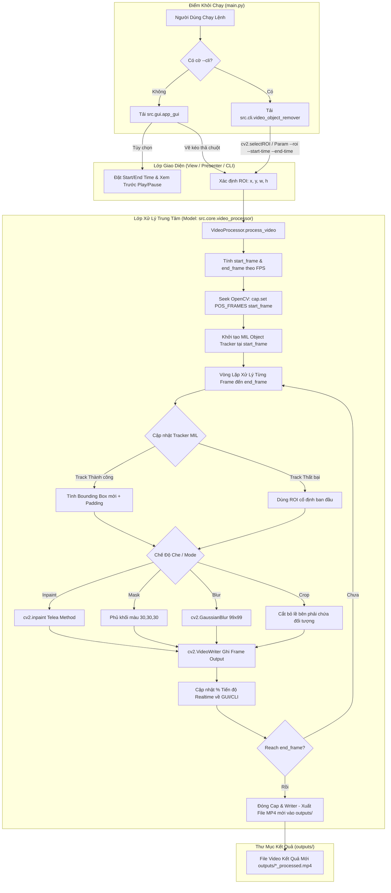

# ARCHITECTURE.md - Tài Liệu Chuyển Giao & Kỹ Thuật (Handover Specification)

> **Dự án:** Ứng Dụng Xóa & Che Đối Tượng Video (Video Object Remover & Masker)
> **Kiến trúc:** MVP (Model - View - Presenter) + Standard Python Package Layout
> **Ngôn ngữ & Thư viện chính:** Python 3.8+, OpenCV (`cv2`), NumPy, Pillow (`PIL`), Tkinter.

---

## 1. Cấu Trúc Thư Mục Chuẩn (Standard Directory Layout)

Dự án được quy hoạch theo chuẩn **Standard Python Project Layout** phân tách các tầng chức năng rõ ràng:

```
chinhsuavideodc/
│
├── main.py                     # 🚀 Entry Point khởi chạy chính (GUI & CLI)
├── requirements.txt            # 📦 Khai báo các thư viện phụ thuộc Python
├── README.md                  # 📖 Tài liệu hướng dẫn sử dụng nhanh
│
├── src/                        # 📁 Mã nguồn ứng dụng chính (Source Code)
│   ├── __init__.py
│   ├── core/                   # 🧠 [MODEL] Thuật toán cốt lõi & Xử lý OpenCV
│   │   ├── __init__.py
│   │   └── video_processor.py
│   ├── gui/                    # 🎨 [VIEW/PRESENTER] Giao diện người dùng Tkinter
│   │   ├── __init__.py
│   │   └── app_gui.py
│   └── cli/                    # 💻 [CLI] Công cụ dòng lệnh
│       ├── __init__.py
│       └── video_object_remover.py
│
├── docs/                       # 📑 Tài liệu kiến trúc & chuyển giao kỹ thuật
│   └── ARCHITECTURE.md
│
├── samples/                    # 🎞️ Dữ liệu mẫu (Video / Hình ảnh) thử nghiệm
└── outputs/                    # 📤 Thư mục tự động lưu trữ các video kết quả xuất ra
```

---

## 2. Tổng Quan Kiến Trúc MVP (Architecture Overview)

Chương trình tuân thủ mô hình **MVP (Model-View-Presenter)**:

* **Model Layer (`src/core/video_processor.py`):** 
  - Đảm nhận toàn bộ logic xử lý ảnh/video: đọc/ghi file video bằng OpenCV, quản lý Object Tracking (MIL Tracker), thực thi 4 phương pháp che đối tượng (`inpaint`, `mask`, `blur`, `crop`).
  - Hỗ trợ cắt/chọn khoảng thời gian xử lý thử nghiệm (`start_time` -> `end_time`) với khả năng Seek OpenCV trong 0ms.
  - Cung cấp API với callback tiến độ phần trăm real-time theo từng khung hình và hỗ trợ dừng xử lý khẩn cấp (`progress_callback`, `stop_checker`).
  - Mặc định tự tạo và xuất kết quả sang file mới trong thư mục `outputs/` (Bảo vệ tuyệt đối file gốc, không ghi đè).

* **View & Presenter Layer (`src/gui/app_gui.py`):**
  - **View:** Quản lý thành phần Tkinter UI (Window, Paned Window, Canvas khoanh vùng ROI, Slider timeline, Bộ điều khiển Xem trước Video Play/Pause/-5s/+5s, Progress bar & % tiến độ nổi bật).
  - **Presenter:** Tiếp nhận tương tác chuột/bàn phím từ người dùng, quản lý phát xem trước mượt mà 30 FPS bằng OpenCV C++ Bilinear Resize, gọi lớp Model `VideoProcessor` trong luồng Thread phụ (`threading.Thread`) để giữ giao diện luôn đáp ứng tốt.

* **CLI Interface (`src/cli/video_object_remover.py`):**
  - Giao diện dòng lệnh độc lập, hỗ trợ đầy đủ cờ `--start-time`, `--end-time`, `--mode`, `--roi`, `--padding`. Tái sử dụng trực tiếp Model `VideoProcessor`.

* **Root Entry Point (`main.py`):**
  - Điều hướng linh hoạt: Chạy GUI với `python main.py` hoặc chạy CLI với `python main.py --cli`.

---

## 3. Sơ Đồ Luồng Dữ Liệu (Dataflow & Block Diagram)



---

## 4. Các Phương Pháp Che & Tính Năng Kỹ Thuật (Technical Specifications)

### 4.1. Các chế độ che đối tượng
| Chế độ (`mode`) | Tên Phương Pháp | Thuật toán / Hàm OpenCV | Mô tả & Tham số Kỹ thuật |
| :--- | :--- | :--- | :--- |
| **`inpaint`** | Xóa & Tái tạo nền | `cv2.inpaint()` | Thuật toán Alexandru Telea (`INPAINT_TELEA`). Bán kính inpaint radius = 5px. Tái tạo nền xung quanh đè lên vùng bị xóa. |
| **`mask`** | Phủ khối màu che | Direct Array Slice Mutation | Đè trực tiếp giá trị pixel màu tối RGB `(30, 30, 30)` lên toàn bộ vùng bounding box của đối tượng. |
| **`blur`** | Làm mờ Gaussian | `cv2.GaussianBlur()` | Sử dụng ma trận làm mờ Kernel Size = `(99, 99)`, độ lệch chuẩn Sigma = `30`. |
| **`crop`** | Cắt viền lề video | Frame Slicing | Cắt bỏ phần lề video từ viền trái ROI trở sang phải `frame[0:height, 0:roi_x]`. Tự động giảm độ rộng file đầu ra. |

### 4.2. Tính năng & Tối ưu hiệu năng mới
- **Ghép nhiều video thành 1 video duy nhất (Video Concatenator / Merger):** Hỗ trợ ghép danh sách nhiều video, tự động chuẩn hóa kích thước (Letterboxing viền đen chống méo), đồng bộ FPS và hỗ trợ OSD Timeline liên tục (Elapsed / Realtime).
- **Cắt / Xử lý theo khoảng thời gian (Time-range Trimming):** Cho phép đặt `start_time` và `end_time` (tính bằng giây). Nhảy frame trực tiếp bằng OpenCV Seek trong 0ms.
- **Trình phát xem trước mượt mà (Preview Player 30 FPS):** Hỗ trợ `▶ Play` / `⏸ Pause`, `⏪ -5s`, `⏩ +5s`. Tối ưu tốc độ vẽ bằng OpenCV C++ Bilinear Resize (`cv2.resize`) nhanh gấp 50 lần so với PIL.
- **Hiển thị tiến độ Realtime nổi bật:** Thanh progress bar và % tiến độ được đưa lên trên các nút bấm chính ở Mục 4, tự động nhảy số theo từng frame giúp quan sát rõ ràng.
- **An toàn dữ liệu tuyệt đối:** File video gốc luôn được mở ở chế độ Read-Only, video đầu ra tự động lưu vào file riêng trong `outputs/`.

---

## 5. Nhật Ký Nâng Cấp & Chuyển Giao (Handover History)

| Phiên bản / Ngày | Thành phần nâng cấp | Mô tả chi tiết |
| :--- | :--- | :--- |
| **v1.2.0** *(20/08/2026)* | **Video Concatenation (Ghép Video)** | Thêm phương thức `VideoProcessor.concatenate_videos` + `resize_with_letterbox`, Tab 2 trên GUI `ttk.Notebook`, CLI cờ `--concat` và script `merge_videos.py`. Test suite đạt 100% pass. |
| **v1.1.0** *(22/07/2026)* | **Time-Range Trimming** | Thêm tham số `start_time` & `end_time` cho Core, GUI và CLI giúp test nhanh video nặng trên các đoạn ngắn 3-10 giây. |
| **v1.1.0** *(22/07/2026)* | **Preview Video Player** | Thêm bộ điều khiển xem trước video (`Play/Pause`, `-5s`, `+5s`) trên Canvas GUI. |
| **v1.1.0** *(22/07/2026)* | **Canvas Speedup** | Tối ưu render canvas bằng OpenCV C++ Bilinear Resize + bù trễ tự động, đưa tốc độ phát xem trước lên 30 FPS realtime mượt mà. |
| **v1.1.0** *(22/07/2026)* | **UI Progress UX Fix** | Cải tạo lại giao diện Mục 4, đưa % tiến độ & progress bar lên vị trí trung tâm nổi bật, cập nhật theo từng frame. |

---

## 6. Hướng Dẫn Mở Rộng Hệ Thống (Developer Extension Guide)

1. **Thêm phương pháp che mới:**
   - Mở `src/core/video_processor.py`, bổ sung hằng số mới vào `ProcessingMode`.
   - Trong hàm `VideoProcessor.process_single_frame()`, thêm khối nhánh `elif mode == ProcessingMode.YOUR_MODE:` để thực thi thuật toán OpenCV mong muốn.
2. **Thay thế thuật toán Object Tracking:**
   - Mở `src/core/video_processor.py` -> `VideoProcessor.create_tracker()`, thay thế `cv2.TrackerMIL_create()` bằng thuật toán mong muốn (như CSRT, KCF hoặc mô hình AI YOLO/SAM 2).
3. **Mở rộng tính năng ghép video:**
   - Gọi trực tiếp `VideoProcessor.concatenate_videos()` hoặc sử dụng script `merge_videos.py` với các tham số tùy biến độ phân giải, FPS và Letterbox.
